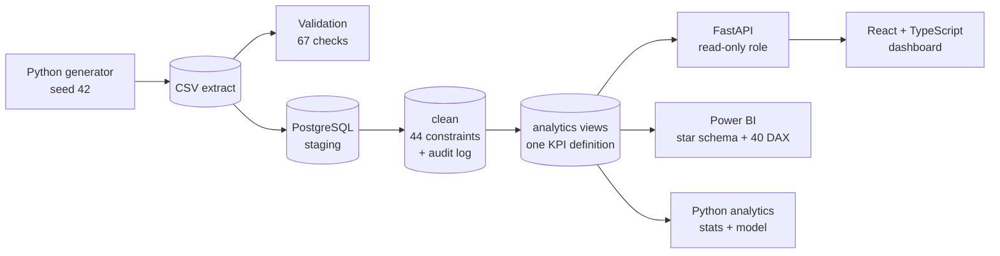

# IT Service Intelligence Platform

**Live demo:** https://it-service-intelligence.vercel.app · **API docs:** https://YOUR-API.onrender.com/docs

**SLA monitoring, incident root-cause analysis and operational performance, built end to end:**
business analysis → synthetic data → PostgreSQL → SQL and Python analytics → FastAPI → React
dashboard → Power BI.

> ⚠️ **All data is synthetic.** Northbridge Managed Services Ltd is a fictional UK managed IT services
> provider. Its 500 customers, 80 agents and 22,000 tickets are generated by code in this repository
> (`scripts/generate_dataset.py`, seed 42). No real organisation or person is represented. This is a
> personal portfolio project.

<!-- Add screenshots here: see docs/screenshots_checklist.md

-->

## The business problem

Ticket volume grew about 20% a year with flat headcount, and management saw rising SLA breaches,
falling satisfaction and recurring incidents, without a trusted view of why. The project turns those
concerns into measurable objectives, finds the drivers, and gives each stakeholder a view that shows
where to act.

## What the analysis found

| | Finding | Evidence |
|---|---|---|
| 📈 | SLA breach rate rose from **14.6% (H1 2024) to 21.5% (H2 2025)**, by +0.38 pts/month (p < 0.001), tracking workload (r = 0.71 across 64 team-quarters) | SQL Q10, Q19; Python §12 |
| 👥 | **Three teams cause 70% of breaches.** After adjusting for work mix, Network Operations breaches **1.87×** its expected rate and carries the highest load (2.95× the lowest team) | Q04, Q34; Python §10 |
| 💎 | **Platinum customers breach 33% of the time vs 4% for Bronze**, with similar handling times: queues aren't ordered by contract tightness | Q06 |
| 🌙 | Out-of-hours P3/P4 tickets to business-hours teams breach **2.7×** as often | Q13 |
| 🔁 | 30 customers generate **52.8% of repeat incidents**; workarounds are reopened **16.4%** of the time vs 6.7% for permanent fixes | Q32, Q35 |
| 🙂 | CSAT is **4.28 when the SLA is met vs 2.88 when breached** (large effect) | Python §7 |
| 🤖 | A creation-time breach-risk model reaches **ROC-AUC 0.85** (rule baseline 0.59) on a chronological hold-out; the top 20% of scores contain 56% of breaches | `docs/model_report.md` |
| 🧪 | Negative control: region was given no effect in the generator, and the method correctly finds none (observed/expected 0.95–1.02) | Q37 |

Eleven prioritised recommendations, each with an owner and a KPI, are in
[`docs/08_findings_and_recommendations.md`](docs/08_findings_and_recommendations.md).

## Architecture



| Layer | Technology |
|---|---|
| Data generation & validation | Python, pandas, NumPy |
| Database | PostgreSQL 16 (staging → clean → analytics, materialised fact, audit schema) |
| Analysis | SQL (37 queries), pandas, SciPy, scikit-learn, matplotlib |
| API | FastAPI, psycopg 3 connection pool, parameterised SQL |
| Dashboard | React 18, TypeScript, Vite, Tailwind CSS, Recharts, React Router, Lucide |
| BI | Power BI (star schema, 40 DAX measures, theme, acceptance values) |
| Business analysis | Requirements, stakeholder map, KPI catalogue, business rules, As-Is/To-Be, user stories |

## Skills demonstrated

| Skill | Where to look |
|---|---|
| Advanced SQL | [`docs/sql_analysis.md`](docs/sql_analysis.md): 37 executed queries (CTEs, window functions, LAG/LEAD, RANK, percentiles, Pareto, GROUPING SETS, indirect standardisation) |
| Data cleaning & quality | [`database/transform_clean.sql`](database/transform_clean.sql), [`data/reports/validation_report.md`](data/reports/validation_report.md) |
| Statistics & EDA | [`docs/python_analysis_report.md`](docs/python_analysis_report.md): chi-square, Mann–Whitney, Kruskal–Wallis, Mantel–Haenszel, Wilson CIs, k-means |
| Predictive modelling | [`docs/model_report.md`](docs/model_report.md): leakage control, chronological split, baselines |
| KPI design | [`docs/04_kpi_catalogue.md`](docs/04_kpi_catalogue.md), [`docs/05_business_rules.md`](docs/05_business_rules.md) |
| Business analysis | [`docs/07_business_analysis_pack.md`](docs/07_business_analysis_pack.md): BRD, FR/NFR status, user stories with Given/When/Then, risks, traceability |
| Stakeholder communication | [`docs/02_stakeholder_map.md`](docs/02_stakeholder_map.md), [`docs/08_findings_and_recommendations.md`](docs/08_findings_and_recommendations.md) |
| Full-stack development | [`backend/`](backend/), [`frontend/`](frontend/), [`docs/api_reference.md`](docs/api_reference.md) |
| Power BI | [`powerbi/README.md`](powerbi/README.md), [`powerbi/measures.dax`](powerbi/measures.dax) |
| Testing & reproducibility | [`docs/testing.md`](docs/testing.md); SQL KPIs reconciled with an independent pandas build (82/82) |

## Quick start

Full instructions for Windows, macOS, Linux, VS Code and Codespaces are in
**[docs/SETUP.md](docs/SETUP.md)**. You need Python 3.11+, PostgreSQL 16 and Node.js 22.

```bash
# 1. Python environment, data, tests          (Windows: powershell -ExecutionPolicy Bypass -File scripts\setup.ps1)
bash scripts/setup.sh

# 2. Fill in .env (DB_ADMIN_PASSWORD, DB_APP_PASSWORD), then build the database
bash database/build_database.sh              # Windows: database\build_database.ps1

# 3. Run the app (two terminals)
bash scripts/start_api.sh                    # http://localhost:8000/docs
bash scripts/start_dashboard.sh              # http://localhost:5173
```

## Repository structure

```
data/         raw/ generated CSVs + manifest · processed/ analytics exports · reference/ DQ answer key · reports/
scripts/      generator, validator, reproducibility, reconciliation, SQL runner, API docs, start scripts, load test
database/     schema, load, clean, constraints, indexes, analytics + Power BI views, grants, checks, build scripts
              queries/ 37 numbered analysis queries + interpretations · query_results/ actual outputs
analytics/    cleaning.py, run_analysis.py (12 analyses), model.py · outputs/ figures, JSON, segments
backend/      FastAPI app: config, db pool, filters (validation), services (SQL), main (routes)
frontend/     React + TypeScript dashboard: 7 pages, shared filters, accessible charts and tables
powerbi/      model guide, 40 DAX measures, theme, acceptance values
docs/         business analysis, KPIs, rules, data dictionary, reports, setup, testing, deployment, portfolio
tests/        dataset, database, analytics, backend and API tests
```

## Documentation

| Business analysis | Data & analysis | Engineering | Career |
|---|---|---|---|
| [Business problem](docs/01_business_problem.md) | [Data dictionary](docs/data_dictionary.md) | [Architecture](docs/00_architecture.md) | [Portfolio pack](docs/09_career_portfolio.md) |
| [Stakeholders](docs/02_stakeholder_map.md) | [Synthetic data design](docs/06_synthetic_data_design.md) | [Setup](docs/SETUP.md) | [Screenshots checklist](docs/screenshots_checklist.md) |
| [Requirements](docs/03_requirements.md) | [Validation report](data/reports/validation_report.md) | [Database import](database/import_instructions.md) | |
| [KPI catalogue](docs/04_kpi_catalogue.md) | [SQL analysis](docs/sql_analysis.md) | [API reference](docs/api_reference.md) | |
| [Business rules](docs/05_business_rules.md) | [Python analysis](docs/python_analysis_report.md) | [Testing](docs/testing.md) | |
| [BA pack](docs/07_business_analysis_pack.md) | [Model report](docs/model_report.md) | [Deployment](docs/deployment.md) | |
| [Findings & recommendations](docs/08_findings_and_recommendations.md) | [Reconciliation](data/reports/reconciliation.md) | [Power BI](powerbi/README.md) | |

## Verification

| Check | Result |
|---|---|
| Dataset reproducible from seed 42 | SHA-256 identical on regeneration |
| Injected data-quality issues detected | 3,213 / 3,219 (99.8%) |
| Database build assertions | 15 / 15 |
| SQL KPIs vs independent pandas implementation | 82 / 82 within rounding |
| Analysis queries executed | 37 / 37 |
| Python tests (data, database, analytics, backend) | 39 / 39 |
| Dashboard TypeScript | Type-checks clean (compile with `npm run build`) |

## Limitations

The data is synthetic, with known mechanisms. The SLA clock uses elapsed hours with no pausing.
Loading is batch only. The model is offline. There is no authentication in the prototype. Details
and future improvements are in [`docs/09_career_portfolio.md`](docs/09_career_portfolio.md#7-five-limitations-and-future-improvements).

---

*Author: [Shubham Mahajan](https://www.linkedin.com/in/shubhammahajanz/)
