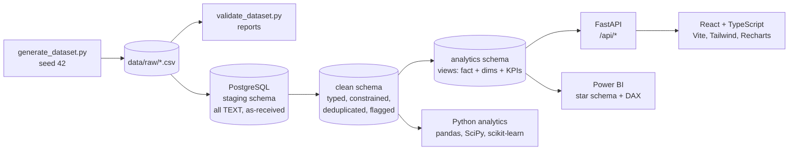

# Architecture overview

> All data in this project is **synthetic**, generated by `scripts/generate_dataset.py`.
> Northbridge Managed Services Ltd is a fictional company.

## Data flow

## Layers

| Layer | Location | Responsibility |
|---|---|---|
| Generation | `scripts/` | Deterministic synthetic data, injected DQ issues with an answer key |
| Validation | `scripts/validate_dataset.py`, `data/reports/` | Structural checks (blocking) and DQ checks (reported) |
| Staging | `database/` `staging.*` | Exact copy of CSVs, all columns `TEXT` so nothing is rejected on load |
| Clean | `database/` `clean.*` | Types, constraints, label standardisation, de-duplication, `dq_flag` columns |
| Analytical | `database/` `analytics.*` views | Business-rule KPIs (breach, FCR, repeat) defined once, reused by API and Power BI |
| Analysis | `analytics/` | EDA, statistics, Pareto, segmentation, breach-risk model |
| API | `backend/` | FastAPI, parameterised SQL against `analytics` views, validation, logging |
| UI | `frontend/` | Five dashboard pages fed only by the API |
| BI | `powerbi/` | Star schema spec, DAX measures, connection guide |
| Docs | `docs/` | Business analysis artefacts, data dictionary, findings |

## Key design decisions

1. **KPI logic lives in SQL views, once.** The API, Power BI and the tests read the same views, so
   "SLA breach rate" cannot mean different things in different places.
2. **Raw data is never edited.** Staging keeps what the source system sent; the clean layer records
   *why* a row was excluded or corrected (`dq_flag`, `dq_notes`), so every exclusion is auditable.
3. **SLA clock = elapsed calendar hours** (documented simplification; see business rules BR-03).
4. **Data quality issues are injected deliberately and logged** in `data/reference/dq_injection_log.csv`.
   The validation checks are written without reading that log and then measured against it.

## Milestones

| # | Scope | Status |
|---|---|---|
| 1 | Phase 1 business definition, Phase 2 dataset + validation | Done |
| 2 | Phase 3 PostgreSQL pipeline, Phase 4 SQL analysis (37 queries, executed) | Done |
| 3 | Phase 5 Python analytics + breach-risk model | Done |
| 4 | Phase 7 FastAPI backend + tests | Done |
| 5 | Phase 6 React frontend | Done |
| 6 | Phase 8 Power BI, Phase 9 BA documentation, Phase 10 delivery, Phase 11 portfolio | Done |
