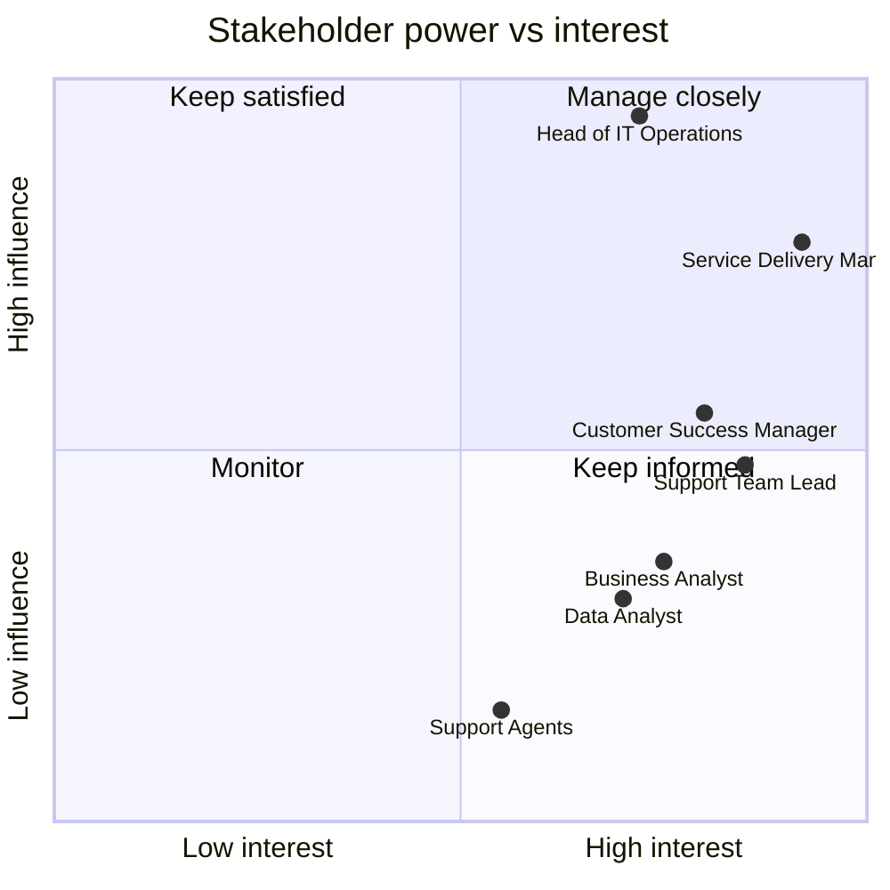

# Stakeholder map

## Power / interest grid

| Quadrant | Stakeholders | Engagement approach |
|---|---|---|
| Manage closely | Head of IT Operations, Service Delivery Manager | Sign off objectives and KPI definitions; fortnightly review of findings |
| Keep informed (high interest) | Customer Success Manager, Support Team Leads, BA, DA | Requirements workshops, UAT, weekly progress notes |
| Monitor / inform | Support Agents | Demo of team view, feedback on usability, clear explanation of how data is used |

## Stakeholder analysis

| Stakeholder | Role in the problem | Key questions | Primary KPIs | Dashboard pages | Concerns / risks | Responsibility |
|---|---|---|---|---|---|---|
| **Head of IT Operations** | Sponsor; owns service performance and budget | Are we getting better or worse? Where should investment go? | SLA breach rate, CSAT, backlog, workload spread | Executive Overview | Wants headline answers, not detail; risk of over-reading short-term movements | Approves scope, objectives and recommendations (A) |
| **Service Delivery Manager** | Accountable for SLA attainment per customer contract | Which priorities, categories and teams breach? Which contracts are at risk? | SLA compliance by priority / team / category, first-response time | SLA Performance, Root Cause | Penalty exposure; needs definitions that match contracts | Owns KPI definitions and business rules (A/R) |
| **Support Team Lead** | Runs a resolver group day to day | How does my team compare? Where is time lost? | Team resolution time, FCR, reopen rate, tickets per agent | Team Performance | Fear of unfair comparisons between teams with different work mixes | Validates team metrics, acts on findings (R) |
| **Support Agents** | Resolve tickets, record root cause and KB usage | Is my data recorded correctly? Does the KB help? | KB usage, FCR | Team Performance (aggregate only) | Surveillance concerns; data entry burden | Data quality at source (R), consulted on To-Be process (C) |
| **Customer Success Manager** | Owns customer relationship and renewals | Which customers are unhappy or at risk of churn? | Customer CSAT, repeat incidents, breach rate per customer | Customer Intelligence | Small CSAT sample sizes per customer | Acts on at-risk list (R), consulted on segmentation (C) |
| **Data Analyst** | Builds the data pipeline, analysis and models | Is the data fit for purpose? | Data quality checks, model metrics | All, plus validation reports | Data quality limits on conclusions | Data pipeline, SQL, analysis (R) |
| **Business Analyst** | Elicits requirements, defines KPIs and processes | What decisions does each stakeholder need to make? | KPI catalogue | All | Scope creep; conflicting KPI definitions | Requirements, process models, acceptance criteria (R) |

R = Responsible, A = Accountable, C = Consulted. The DA and BA roles are played by the project
author in this portfolio project.

## Communication plan

| Audience | Format | Frequency | Content |
|---|---|---|---|
| Head of IT Ops | One-page summary + Executive Overview page | Monthly | KPI vs target, top three issues, decisions needed |
| Service Delivery Manager | SLA Performance page, breach exception list | Weekly | Breaches by priority/team/category, at-risk contracts |
| Team Leads | Team Performance page | Weekly | Team scorecard, trend, reopen and FCR drivers |
| CSMs | Customer Intelligence page | Monthly | At-risk customer list with evidence |
| Agents | Team stand-up | Fortnightly | KB usage, data-entry quality feedback |

## Conflicts to manage

- **Team comparability.** Team Leads object to raw comparisons because work mixes differ: Network
  Ops handles more complex work than the Service Desk. *Mitigation:* show metrics by priority and
  complexity within each team, alongside the headline figure.
- **Speed vs quality.** Pressure on resolution time can drive premature closures and more reopens.
  *Mitigation:* always pair resolution time with reopen rate on the same view.
- **CSAT reliability.** CSMs want customer-level CSAT, but samples are small. *Mitigation:* show the
  response count with every average and suppress customers with fewer than 5 responses.
