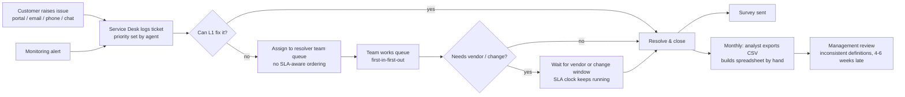
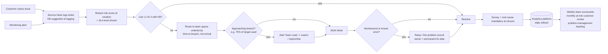

# Business analysis pack (Phase 9)

> **Synthetic scenario.** Northbridge Managed Services Ltd is fictional, and every figure comes from
> generated data. Numbers are taken from the PostgreSQL analytics layer (`docs/sql_analysis.md`) and
> the Python analysis (`docs/python_analysis_report.md`). The two were reconciled to within rounding
> (`data/reports/reconciliation.md`).

| # | Artefact | Where |
|---|---|---|
| 1 | Business requirements document | Section 1 (this file) |
| 2 | Functional requirements | Section 2, plus `03_requirements.md` |
| 3 | Non-functional requirements | Section 3 |
| 4 | Stakeholder analysis | `02_stakeholder_map.md` |
| 5 | KPI definitions | `04_kpi_catalogue.md` |
| 6 | Business rules | `05_business_rules.md` |
| 7 | Assumptions and constraints | `01_business_problem.md` sections 5–6 |
| 8 | Data quality assessment | Section 4 |
| 9 | As-Is process | Section 5 |
| 10 | To-Be process | Section 6 |
| 11 | User stories (12) | Section 7 |
| 12 | Given/When/Then acceptance criteria | Section 7 |
| 13 | Risks and mitigations | Section 8 |
| 14 | Root cause findings | `08_findings_and_recommendations.md` |
| 15 | Actionable recommendations | `08_findings_and_recommendations.md` |

Requirements (what the business needs) are kept separate from implementation decisions (how this
project meets them). Section 9 traces each requirement to its implementation and to the test that
verifies it.

---

## 1. Business requirements document

**1.1 Purpose.** To give Northbridge's operations leadership a single, trusted view of SLA
performance, the causes of breaches and repeat incidents, team workload and customer risk, so they
can decide where to act.

**1.2 Background.** Ticket volume grew about 20% year on year (12,072 tickets in 2025 against 10,018
in 2024) with flat headcount. Over the same period, the SLA breach rate rose from 14.6% (H1 2024) to
21.5% (H2 2025) and customer satisfaction fell from 4.03 to 3.90. Management currently relies on
monthly spreadsheets assembled by hand. These use inconsistent definitions, for example whether
cancelled or duplicate tickets count as breaches.

**1.3 Business objectives.** OBJ-01 to OBJ-11 in `01_business_problem.md` section 3. Each has a
measured baseline and a target for H2 2026.

**1.4 Scope.** See `01_business_problem.md` section 4. In scope: tickets for 2024–2025, SLA and
root-cause analysis, team and customer views, and an exploratory risk model. Out of scope: real-time
ITSM integration, financial penalty modelling, and SLA clock pausing.

**1.5 Stakeholders.** See `02_stakeholder_map.md`. The sponsor is the Head of IT Operations; the
Service Delivery Manager owns the KPI definitions.

**1.6 Business requirements.** BR-01 to BR-09 in `03_requirements.md`. In summary, the business must
be able to:
- see SLA compliance and its trend by any dimension (BR-01)
- identify the root causes and categories that drive breaches (BR-02)
- compare teams fairly (BR-03)
- find customers needing support (BR-04)
- quantify repeat incidents (BR-05)
- understand what drives satisfaction (BR-06)
- anticipate breaches (BR-07)
- use one set of KPI definitions everywhere (BR-08)
- see data-quality issues openly (BR-09)

**1.7 Success criteria.**
1. All five stakeholder views are available, with filters.
2. The same KPI value appears in SQL, the API, the web dashboard and Power BI (NFR-02).
3. Every data exclusion is traceable to a business rule.
4. Stakeholders confirm the findings are actionable (sign-off in UAT).

---

## 2. Functional requirements (status)

| ID | Requirement (summary) | Status | Implemented by |
|---|---|---|---|
| FR-01 | Headline KPIs | Met | `/api/overview` → Executive overview page (8 KPIs) |
| FR-02 | Comparison with previous period | Met | Same-length previous window, in both the API and DAX |
| FR-03 | Monthly trends | Met | `/api/trends`; overview charts |
| FR-04 | Filters: date, priority, team, category, region | Met | Shared filter bar, held in the URL; validated server-side |
| FR-05 | SLA by priority, category, team, region | Met | `/api/sla-performance` → SLA page |
| FR-06 | Resolution and first-response distributions | Met | Distribution and first-response charts |
| FR-07 | Root-cause Pareto | Met | `/api/root-causes` → Pareto (single % axis) |
| FR-08 | Root cause × priority matrix | Met | Heatmap matrix |
| FR-09 | Escalation analysis | Met | Escalation chart and table |
| FR-10 | Team comparison table | Met | `/api/team-performance` → Team page |
| FR-11 | Customer list: search, sort, paginate | Met | `/api/customer-analysis` (server-side) |
| FR-12 | At-risk customer flag (BR-RULE-14) | Met | `analytics.customer_risk` → "At risk" badge |
| FR-13 | Ticket drill-down | Met | `/api/tickets` → Tickets page |
| FR-14 | Data-quality exceptions visible | Met | `/api/data-quality` → Data quality page; `audit.dq_issues` |
| FR-15 | Sample size shown with averages | Met | CSAT shows the response count; at-risk and table rules need ≥ 5 responses |
| FR-16 | Breach-risk estimate | Partly met | Offline model (`docs/model_report.md`); not yet served by the API |
| FR-17 | Edit/close tickets | Won't (by design) | The platform is read-only |

## 3. Non-functional requirements (status)

| ID | Requirement | Status / evidence |
|---|---|---|
| NFR-01 | p95 API response < 1 s | The 37 analysis queries over the full dataset each run in 45–320 ms, including `psql` start-up (`docs/sql_analysis.md`). The 15 backend tests run every endpoint's SQL in under 5 s in total. API p95 under load still needs measuring locally (`docs/testing.md`) |
| NFR-02 | KPIs agree to 0.1 pp across tools | 82/82 SQL-vs-pandas comparisons pass; Power BI acceptance values come from an independent implementation |
| NFR-03 | Reproducible | Seed 42; SHA-256 manifest; `check_reproducibility.py` |
| NFR-04 | No credentials in code; read-only role | `.env` only; `itsi_app` can read `analytics` only (tested) |
| NFR-05 | Parameterised SQL | psycopg parameters; sort-column whitelist; injection test passes |
| NFR-06 | Chart usability | Titles, axis units, tooltips, legends; a table view for every chart |
| NFR-07 | Accessibility (WCAG 2.1 AA) | Labelled controls, visible focus, `aria-sort`, keyboard-usable menus, reduced-motion support; an audit with axe or Lighthouse is still to be done |
| NFR-08 | Responsive 375–1920 px | Responsive grid and mobile navigation drawer |
| NFR-09 | Loading, empty and error states; HTTP codes | Every panel has all three states; the API returns 422, 503 or 404 as appropriate |
| NFR-10 | Automated tests | 39 Python tests (data 11, database 7, analytics 6, backend 15) and 15 database assertions, all passing; HTTP-level API tests run where FastAPI is installed (`docs/testing.md`) |
| NFR-11 | Auditability | Every correction is recorded in `audit.dq_issues` with its rule ID |
| NFR-12 | Agent data aggregated | Dashboard views stay at team level; the Tickets page shows the team, not the agent |
| NFR-13 | Authentication | Not implemented (prototype); listed as a gap |

---

## 4. Data quality assessment

| Dimension | Finding | Impact | Treatment |
|---|---|---|---|
| **Completeness** | CSAT missing on 59% of tickets (survey non-response); root cause missing on 4% of resolved tickets; KB flag missing on 3% | CSAT averages rest on about 42% of resolved tickets; Pareto excludes 891 tickets | Report response counts; exclude from Pareto; ask agents to record root cause (recommendation R9) |
| **Uniqueness** | 25 exact duplicate rows; 131 near-duplicates (same customer and issue re-logged within 15 minutes) | Without treatment, volume and breaches are overstated | Collapsed or excluded (BR-RULE-01) |
| **Validity** | 45 CSAT scores outside 1–5; 44 records with impossible timestamps; 8 closed tickets with no resolution time | Would distort averages and produce negative durations | Set to missing or excluded from duration KPIs (BR-RULE-06/07) |
| **Consistency** | 555 non-standard category labels (for example "Netwrk", "H/W"); 88 region label variants; 66 FCR flags contradicted by escalation or reopen | Categories would split; FCR would be inflated | Mapped to the controlled list; contradictory FCR excluded (BR-RULE-09/12) |
| **Accuracy (plausibility)** | 83 tickets resolved after more than 30 days or more than 10× target; 12 P1 tickets marked "Low" impact; 111 tickets assigned to an agent outside the resolver team | Inflates averages; points to triage or assignment process gaps | Outliers excluded from averages but kept in breach rate; others listed for investigation |
| **Referential integrity** | 10 tickets reference customers missing from the master data | Customer analysis incomplete | Assigned to an "Unknown" customer (BR-RULE-13) |
| **Timeliness** | Single extract at 31 December 2025 | Open tickets have no outcome yet | Backlog reported separately |

**Overall:** 13.8% of raw rows carry at least one issue, most of them minor (missing optional fields
or label variants). After cleaning, 22,090 tickets support every KPI. The validation checks detected
3,213 of the 3,219 issues deliberately injected into the data (99.8%).

---

## 5. As-Is process

**Pain points (with evidence):**
1. Queues are worked first-in-first-out, so tight Platinum targets breach. Platinum breaches 33.2%
   against 3.7% for Bronze, with similar handling times (Q06).
2. Out-of-hours P3/P4 tickets wait for the next working day while the clock runs. They breach 2.7
   times as often (Q13).
3. There is no early warning. 45.5% of breaches miss the target by less than 50% (Q26) and could
   have been recovered.
4. Workarounds close tickets that come back: 16.4% of workarounds are reopened (Q35).
5. Reporting is manual and late, so recurring problems (chronic customers, change-related
   incidents) go unnoticed.

## 6. To-Be process

**What changes:** SLA-aware routing (R1), a pre-breach alert (R2), out-of-hours triage or clock
rules (R3), linking problem records to recurring workarounds (R5), mandatory root cause at closure
(R9), and automated daily reporting in place of manual monthly spreadsheets.

---

## 7. User stories and acceptance criteria

Format: *As a [role], I want [capability], so that [benefit]*, followed by Given/When/Then criteria.
Each story is traced to its requirement.

**US-01 – Headline performance** (FR-01, FR-02; Head of IT Operations)
As the Head of IT Operations, I want to see the headline KPIs for a period next to the previous
period, so that I can tell at a glance whether service is improving.
- *Given* the dashboard has loaded with the default period (the last six months), *when* I open
  the Executive overview, *then* I see total tickets, open tickets, SLA compliance %, breach %,
  average resolution time, FCR %, reopen % and average CSAT. Each shows its change against the
  same-length previous period.
- *Given* a KPI got worse, *when* its change is shown, *then* it is marked "worse" with a downward
  or upward icon and text, not by colour alone.
- *Given* I choose a period starting on the first day of the data, *when* no previous period
  exists, *then* the card says "No previous period" instead of showing a misleading change.

**US-02 – SLA by priority** (FR-05; Service Delivery Manager)
As a Service Delivery Manager, I want SLA compliance broken down by priority, so that I know which
contractual targets are most at risk.
- *Given* any filter selection, *when* I open SLA performance, *then* I see compliance %,
  first-response %, median and 90th-percentile resolution for P1–P4.
- *Given* I select team "Network Operations", *when* the page refreshes, *then* every chart shows
  only that team's tickets, and the filter appears in the URL so the view can be shared.

**US-03 – Breaches by category** (FR-05; Service Delivery Manager)
As a Service Delivery Manager, I want to see which categories cause the most breaches, so that I can
target improvement work.
- *Given* the SLA page, *when* I view "Breaches by category", *then* categories are ranked by breach
  count, and the breach rate appears in the tooltip and in the table view.

**US-04 – Root-cause Pareto** (FR-07; Problem Manager / SDM)
As a Problem Manager, I want a Pareto of incident root causes, so that I can focus on the few causes
behind most incidents.
- *Given* the Root causes page, *when* it loads, *then* bars show each cause's share of incidents and
  a line shows the cumulative share, both on one 0–100% axis, with an 80% reference line.
- *Given* service requests exist, *when* the Pareto is calculated, *then* they are excluded
  (BR-RULE-11).

**US-05 – Repeat incidents** (FR-11, BR-05; Customer Success Manager)
As a Customer Success Manager, I want to see the customers and issues that keep recurring, so that I
can push for permanent fixes.
- *Given* the Root causes page, *when* I view "Repeat incidents", *then* I see the repeat rate and
  the top customer–issue pairs, with the most common root cause for each.
- *Given* an incident from the same customer and subcategory 31 days after the previous one,
  *when* repeats are counted, *then* it is not a repeat (30-day rule, BR-RULE-10).

**US-06 – Fair team comparison** (FR-10; Support Team Lead)
As a Support Team Lead, I want my team compared with others on the same KPIs, including workload, so
that comparisons are fair and I can explain our figures.
- *Given* the Team performance page, *when* it loads, *then* a sortable table shows tickets, tickets
  per agent per month, median resolution, SLA compliance, CSAT, reopen %, FCR %, escalation % and open
  tickets for all eight teams.
- *Given* I sort by SLA compliance, *when* I click the column header, *then* the order reverses and
  the header announces its sort state to screen readers.

**US-07 – Workload balance** (FR-10, OBJ-05; Head of IT Operations)
As the Head of IT Operations, I want to compare tickets per agent across teams, so that I can
rebalance headcount.
- *Given* the metric selector on the Team page, *when* I choose "Tickets per agent per month",
  *then* the bar chart ranks teams by load. Workload uses planned headcount and the months in the
  selected range (BR-RULE-16).

**US-08 – Customer table** (FR-11; Customer Success Manager)
As a Customer Success Manager, I want to search, sort and page through customers, so that I can find
the account I'm preparing for.
- *Given* the Customers page, *when* I type part of a customer name, *then* the table filters
  server-side within half a second of my last keystroke.
- *Given* more than 15 customers match, *when* I use the page controls, *then* the next page loads
  without repeating rows, and the table shows "16–30 of N".
- *Given* I type `%` or `'` in the search box, *when* the search runs, *then* those characters are
  treated as plain text, not SQL.

**US-09 – At-risk customers** (FR-12, OBJ-11; Customer Success Manager)
As a Customer Success Manager, I want customers flagged at risk with the reasons, so that I can
prioritise my monthly reviews.
- *Given* a customer with at least 10 resolved tickets in the last 90 days, *when* two or more of
  these hold: breach rate ≥ 1.5 × the company rate, repeat rate ≥ 20%, CSAT ≤ 3.5 with ≥ 5
  responses, *then* the customer shows an "At risk" badge (BR-RULE-14).
- *Given* a customer has fewer than 5 survey responses, *when* risk is calculated, *then* the CSAT
  criterion is not applied.

**US-10 – Escalation impact** (FR-09; Support Team Lead)
As a Support Team Lead, I want to see how escalation affects resolution time at each priority, so
that I can judge whether escalations are timely and necessary.
- *Given* the Root causes page, *when* I view "Escalation analysis", *then* I see median resolution
  for escalated and non-escalated tickets side by side per priority, with breach rates in the table
  view.

**US-11 – Trustworthy data** (FR-14, BR-09; Data Analyst)
As a Data Analyst, I want every correction the pipeline makes to be visible with its rule, so that
stakeholders can trust and audit the numbers.
- *Given* the Data quality page, *when* it loads, *then* each rule is listed with the issue, the
  action taken and the number of records.
- *Given* a ticket has a resolution time before its creation time, *when* KPIs are calculated, *then*
  it counts in volume but not in duration or SLA KPIs, and appears in the investigation list.

**US-12 – Drill-down to tickets** (FR-13; Service Delivery Manager)
As a Service Delivery Manager, I want to list the tickets behind a number, so that I can check
individual cases before a customer meeting.
- *Given* the Tickets page with filters applied, *when* I choose the "Breached" tab, *then* only
  breached tickets in the filtered set are listed, newest first, 25 per page.
- *Given* the API is not running, *when* the page loads, *then* I see an error explaining that the
  API can't be reached, how to start it, and a "Try again" button.

**US-13 – Consistent KPIs in Power BI** (BR-08, NFR-02; Head of IT Operations)
As the Head of IT Operations, I want the Power BI report to show the same numbers as the web
dashboard, so that two reports never contradict each other in a meeting.
- *Given* the Power BI model is built from `powerbi/README.md`, *when* no slicers are applied,
  *then* it shows the values in `powerbi/expected_values.md`, for example SLA Breach % = 18.15%.

---

## 8. Risks and mitigations

| # | Risk | Likelihood | Impact | Mitigation | Owner |
|---|---|---|---|---|---|
| RK-01 | KPI definitions disputed by teams ("our breaches aren't our fault") | High | High | Definitions signed off by the SDM before build; rules published in the dashboard; adjusted comparisons shown (`python_analysis_report.md` section 10) | SDM |
| RK-02 | Root-cause field unreliable (agent-entered, 4% missing) | High | Medium | Mandatory field at closure (R9); Pareto shows its "known root cause" denominator; periodic QA sampling | Team Leads |
| RK-03 | Metrics used to blame individual agents | Medium | High | Team-level views only; no agent league tables; model not used for performance management | Head of IT Ops |
| RK-04 | Speed targets drive premature closure (more reopens) | Medium | Medium | Reopen rate always shown next to resolution time; FCR excludes reopened tickets | SDM |
| RK-05 | CSAT bias (unhappy customers respond more) | Certain | Medium | Report response rate; don't compare small samples; raise response rate (OBJ-07) | CSM |
| RK-06 | Elapsed-hours SLA clock disputed against contracts | Medium | High | Documented as assumption A-03; business-hours or paused clock is a scoped change request | SDM |
| RK-07 | Data extract stale or incomplete | Medium | Medium | Snapshot date shown in the UI; automated checks fail the build on structural problems | DA |
| RK-08 | Model drift as volume grows | High | Low | Chronological evaluation; retrain monthly; monitor precision and recall | DA |
| RK-09 | No authentication in the prototype | Certain | High (if exposed) | Run locally only; add SSO and role-based access before any shared deployment (`docs/deployment.md`) | BA / IT |
| RK-10 | Synthetic-data findings mistaken for real ones | Low | High | Synthetic labelling on every page, report and README | Author |

---

## 9. Traceability: requirement → implementation → test

| Requirement | Implementation | Verified by |
|---|---|---|
| BR-08 one KPI definition | `analytics_views.sql` (`fact_tickets` populations) | `reconcile_db.py` (82 checks); `test_database.py`; Power BI `expected_values.py` |
| BR-09 visible data quality | `transform_clean.sql` → `audit.dq_issues`; `/api/data-quality` | `checks.sql` C15; `validate_dataset.py` detection table |
| FR-02 previous period | `Filters.previous_period()`; DAX "Previous Period" | `test_backend.py::test_previous_period_same_length` |
| FR-04 filters | `filters.py` validation and parameterised WHERE | `test_backend.py` (validation, partition), `test_api.py` (422s) |
| FR-07 Pareto | `services.root_causes` | `test_backend.py::test_root_cause_pareto_ends_at_100`; `checks.sql` C12 |
| FR-11 search/sort/paginate | `services.customer_analysis` | `test_backend.py::test_customer_analysis_pagination_search_sort` |
| NFR-04/05 security | `grants.sql`, `db.py` read-only sessions, sort whitelist | `test_database.py::test_app_role_is_read_only`; `test_backend.py::test_search_input_cannot_inject_sql` |
| FR-16 breach risk | `analytics/model.py` | `test_analytics.py` leakage tests; `docs/model_report.md` |
