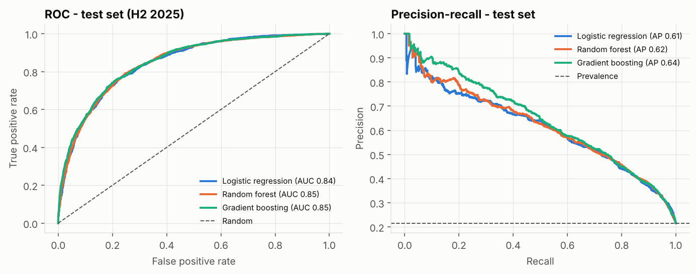
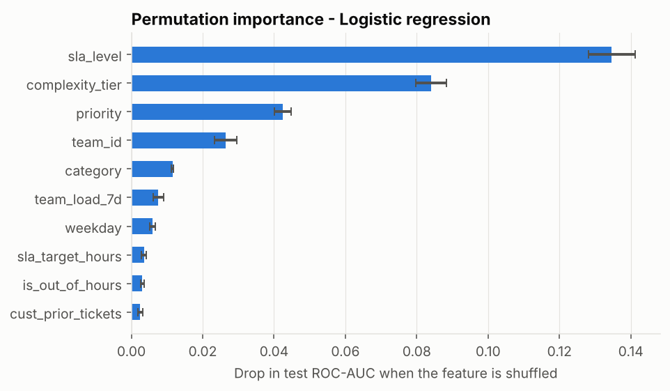

# SLA breach-risk model

> Synthetic data. Generated by `analytics/model.py`; all metrics in `analytics/outputs/model_metrics.json`.

## Question

At the moment a ticket is **logged**, how likely is it to breach its SLA? A risk score at creation lets a Team Lead route or prioritise tickets before the clock runs out.

## Leakage control

Only information available at creation time is used. History features (team load in the previous 7 days, customer's prior tickets and prior breach rate) are computed from **earlier** tickets only, and a prior breach counts only if that ticket was already resolved when the new ticket arrived.

Excluded because they are only known later: resolution time, first response, escalation, reopens, FCR, root cause, resolution type, knowledge-base use, CSAT, status.

Categorical features: priority, category, complexity_tier, channel, team_id, sla_level, company_size, weekday. Numeric features: sla_target_hours, hour, is_out_of_hours, team_load_7d, cust_prior_tickets, cust_prior_breach_rate, cust_prior_resolved.

## Chronological split

| set | from | to | tickets | breach_rate_pct |
|---|---|---|---|---|
| train | 2024-01-01 | 2025-03-31 | 12,848 | 16.49 |
| valid | 2025-04-01 | 2025-06-30 | 2,783 | 18.65 |
| test | 2025-07-01 | 2025-12-31 | 5,880 | 21.53 |

The decision threshold for each model is chosen on the **validation** quarter (maximum F1), and the final model is chosen on validation ROC-AUC. The test half-year is scored once. The breach rate rises over time, so the test set is harder than the training data - a realistic deployment condition.

## Results on the test set (H2 2025)

| model | threshold | precision | recall | f1 | roc_auc | pr_auc | valid_roc_auc |
|---|---|---|---|---|---|---|---|
| Baseline: always 'no breach' | 0.50 | 0.00 | 0.00 | 0.00 | 0.50 | 0.21 |  |
| Baseline: rule (P1/P2 on Platinum/Gold) | 0.50 | 0.49 | 0.26 | 0.34 | 0.59 | 0.29 | 0.59 |
| Logistic regression | 0.65 | 0.53 | 0.67 | 0.59 | 0.84 | 0.61 | 0.85 |
| Random forest | 0.59 | 0.55 | 0.65 | 0.59 | 0.85 | 0.62 | 0.85 |
| Gradient boosting | 0.66 | 0.57 | 0.63 | 0.60 | 0.85 | 0.64 | 0.85 |

Chosen model: **Logistic regression** (highest validation ROC-AUC; models within 0.005 of the best are treated as tied and the simplest, most explainable one is preferred). Confusion matrix on test at threshold 0.651:

| | Predicted no breach | Predicted breach |
|---|---:|---:|
| **Actual no breach** | 3,859 | 755 |
| **Actual breach** | 413 | 853 |

**Lift.** The 10% of test tickets with the highest risk score breach at 70.6% (vs 21.53% overall) and contain 32.8% of all breaches; the top 20% contain 55.6%.

## Limitations

1. **Synthetic data.** The generator's breach mechanism is known (docs/06_synthetic_data_design.md); a model that recovers it is evidence the pipeline works, not that these features predict breaches in a real service desk.
2. **Moderate discrimination by design.** Most of the variation in resolution time comes from events after logging (escalation, reopens, the work itself) that the model is deliberately not allowed to see. A model scored again at first response, or hourly while a ticket is open, would do better.
3. **Calibration** was not tuned (class weights shift probabilities up); scores rank tickets well but should not be read as exact probabilities without calibration (e.g. isotonic on validation).
4. **Drift.** Breach rates rise over the period; the model must be retrained regularly and monitored on recent data.
5. **Associations, not causes.** Feature importance shows what helps prediction, not what to change; for example SLA level matters because targets differ, not because customers behave differently.
6. **Fairness to teams.** Team is a feature; a risk score must not be used to judge individual agents.
