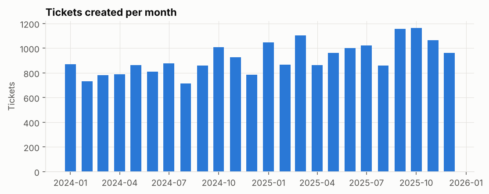
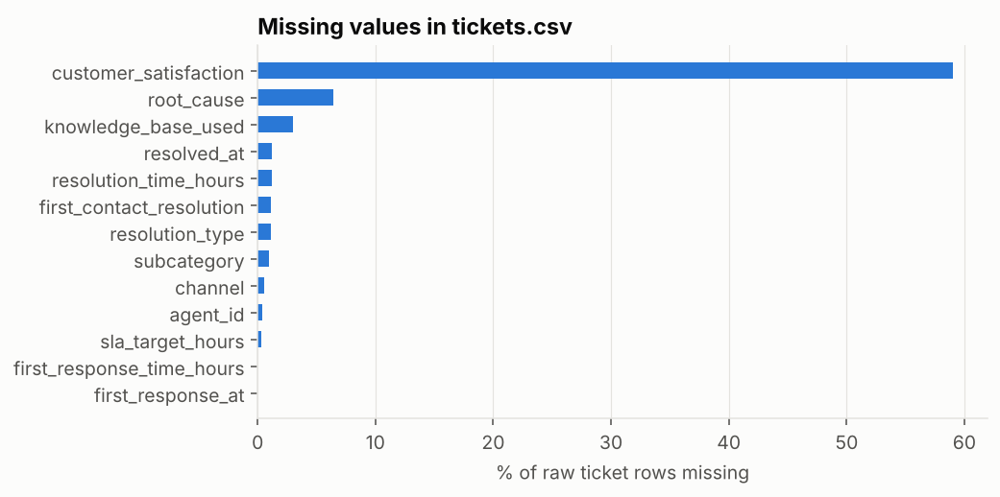
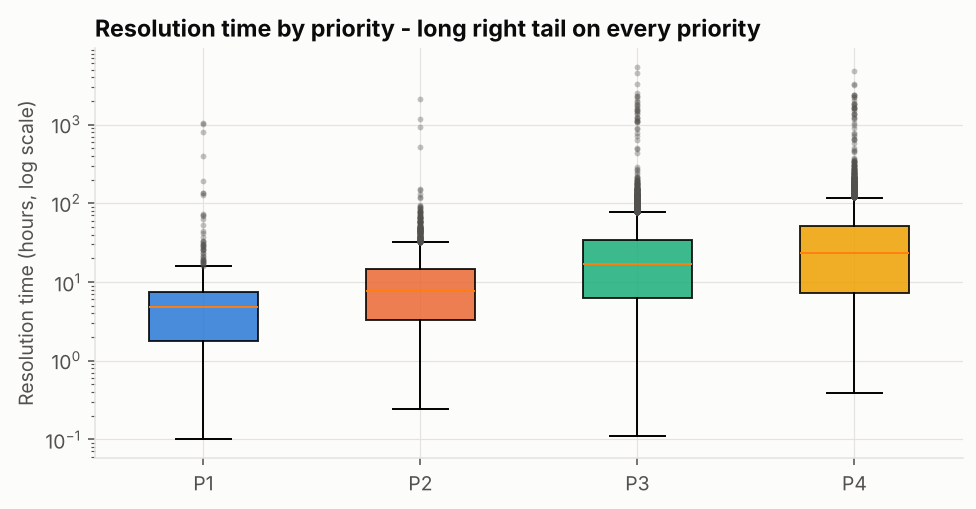
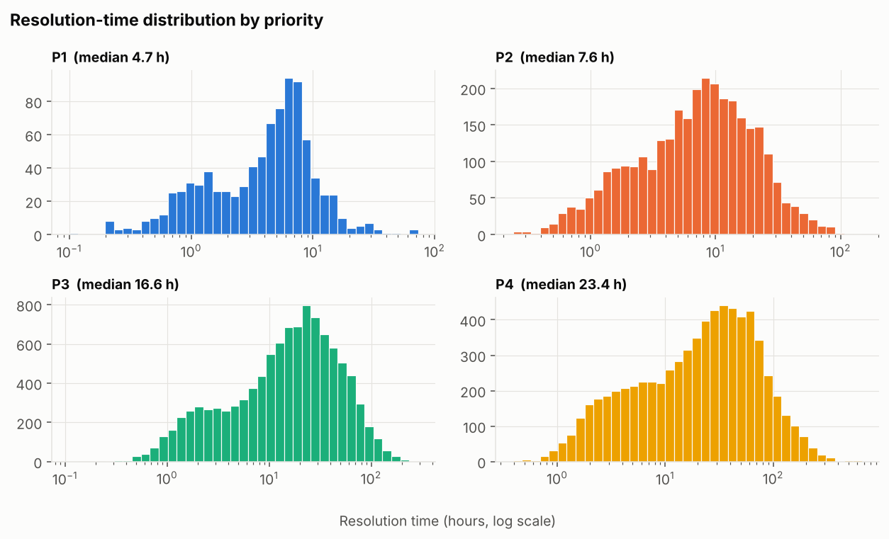
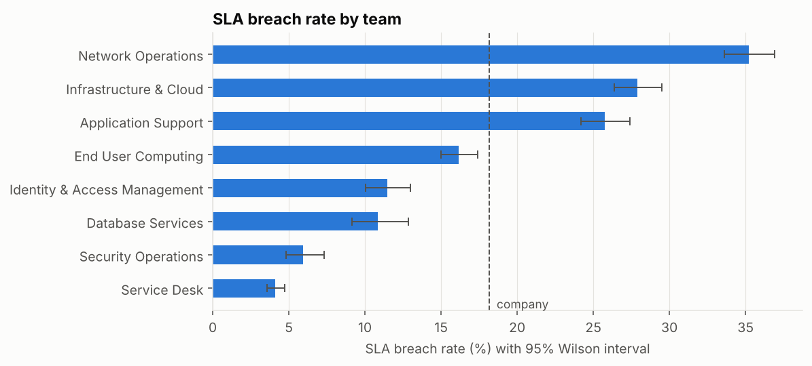
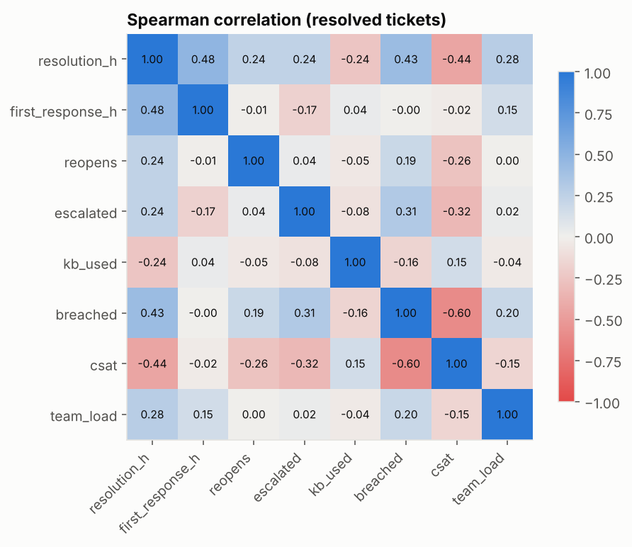
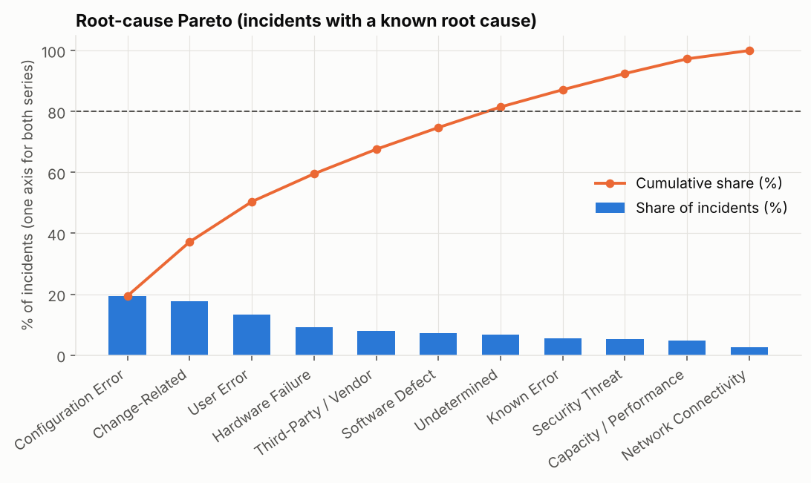
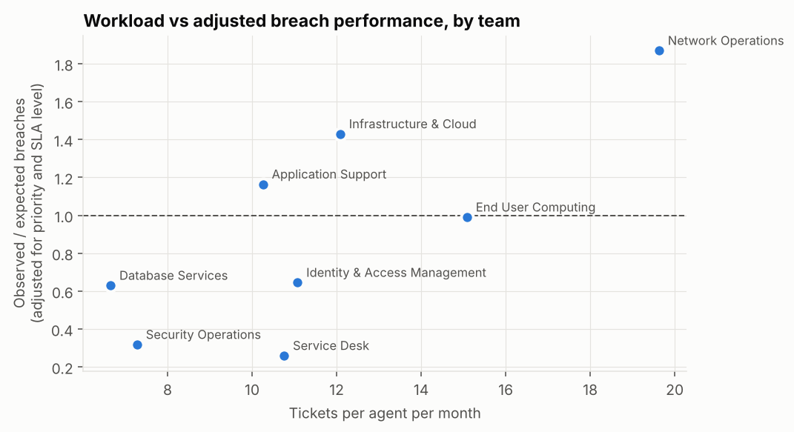
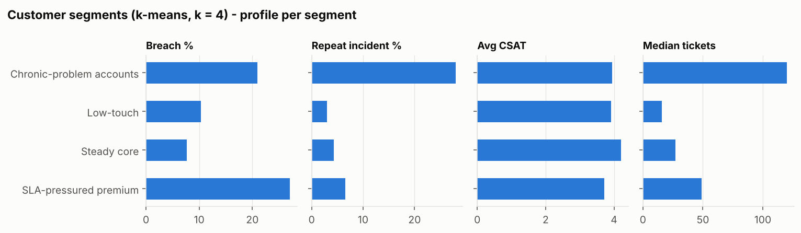
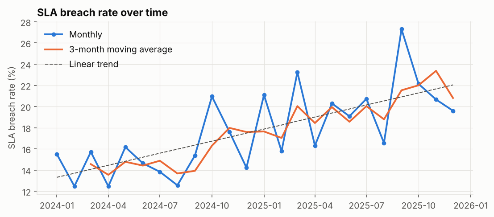

# Python analysis report (Phase 5)

> Synthetic data - Northbridge Managed Services Ltd is fictional. Every number below is computed by `analytics/run_analysis.py`; all values are also in `analytics/outputs/analysis_results.json`. Statistical association is not causation; the generator's built-in mechanisms are listed in `docs/06_synthetic_data_design.md`.

## Key findings

1. **Service is getting worse at a measurable rate.** The SLA breach rate rises by 0.38 percentage points per month (p < 0.001), from about 14% in early 2024 to 20–23% in late 2025. Over the same period, monthly volume grows by about 13 tickets a month, while headcount is flat. Volume and breach rate move together month by month (Spearman ρ = 0.91).
2. **Team breach gaps survive adjustment for work mix.** After adjusting for priority and contract level, Network Operations breaches 1.87 times as often as its work mix predicts, and Infrastructure & Cloud 1.43 times. The Service Desk and Security Operations come in well below expectation (0.26 and 0.32).
3. **Platinum customers have the worst experience.** They breach 33% of the time, against 4% for Bronze, because their targets are tighter while handling times are similar.
4. **Breaches are strongly associated with lower satisfaction.** Average CSAT is 4.28 when SLA is met and 2.88 when it is breached, a large effect (rank-biserial 0.78).
5. **Recurring problems are concentrated.** A segment of 52 "chronic-problem" accounts has a 28% repeat-incident rate. Two root causes, third-party/vendor issues and change-related incidents, produce the most breaches above what their volume would predict.
6. **A creation-time model can rank breach risk.** On the held-out final six months it reaches ROC-AUC 0.85, against 0.59 for a simple business rule. The top 20% of scored tickets contain 56% of all breaches ([model report](model_report.md)).

See also: [breach-risk model](model_report.md).

## 1. Exploratory data analysis

The analysis table has **22,090 tickets** (duplicates removed) and 53 columns, covering 2024-01-01 to 2025-12-31, 500 customers and 8 teams.

| column | count | mean | std | min | 25% | 50% | 75% | max |
|---|---|---|---|---|---|---|---|---|
| resolution_time_hours | 21,832.00 | 31.89 | 113.05 | -92.75 | 5.24 | 14.91 | 34.69 | 5,428.24 |
| first_response_time_hours | 22,085.00 | 5.54 | 10.86 | -9.67 | 0.64 | 1.85 | 5.12 | 254.92 |
| reopened_count | 22,090.00 | 0.07 | 0.28 | 0.00 | 0.00 | 0.00 | 0.00 | 3.00 |
| customer_satisfaction | 9,020.00 | 3.97 | 0.92 | 1.00 | 3.00 | 4.00 | 5.00 | 5.00 |
| sla_target_hours | 22,090.00 | 61.67 | 40.34 | 4.00 | 24.00 | 72.00 | 96.00 | 168.00 |

| dimension | distinct_values | most_common |
|---|---|---|
| priority | 4 | P3 |
| category | 10 | Access & Identity |
| channel | 5 | Portal |
| team_id | 8 | T01 |
| region | 8 | London |
| ticket_status | 7 | Closed |

**Interpretation.** The data covers two full years, with a clear upward volume trend and dips in August and December. There are 500 customer IDs, which includes the Unknown placeholder used for orphan tickets. The numeric columns are heavily right-skewed. For example, the maximum resolution time is far above the 75th percentile, so the analysis relies on medians, percentiles and rank-based tests.

## 2. Data cleaning

`analytics/cleaning.py` re-implements the business rules in pandas, straight from the raw CSVs, and logs every step:

| step | rule | rows_affected |
|---|---|---|
| Raw rows loaded | - | 22,246 |
| Exact duplicate rows collapsed | BR-RULE-01 | 25 |
| Category labels standardised | BR-RULE-12 | 555 |
| Region labels standardised | V04 | 88 |
| Orphan customer_id -> CUST-UNKNOWN | BR-RULE-13 | 10 |
| Missing SLA target derived from rules | BR-RULE-15 | 66 |
| Invalid timestamps flagged | BR-RULE-06 | 52 |
| Resolution outliers flagged | BR-RULE-08 | 83 |
| Out-of-range CSAT set to missing | BR-RULE-07 | 45 |
| Contradictory FCR flagged | BR-RULE-09 | 66 |
| Near-duplicates flagged (excluded from KPIs) | BR-RULE-01 | 131 |
| Missing root_cause kept as NULL | M02 | 891 |
| Missing knowledge_base_used kept as NULL | M03 | 669 |
| Missing channel kept as NULL | M04 | 132 |
| Missing subcategory kept as NULL | M05 | 222 |

**Cross-check against PostgreSQL:** pandas produces 22,090 KPI-eligible tickets and the SQL fact table has 22,090; the ticket IDs are identical. The SLA breach rate is 18.15% in pandas and 18.15% in SQL. Two independent implementations agree.

**Interpretation.** Every cleaning step is logged with a count. The largest corrections are category labels (555 rows), missing root causes (891) and missing knowledge-base flags (669). The pandas pipeline and the SQL pipeline produce identical KPI populations, ticket for ticket, which demonstrates that the business rules are unambiguous enough to implement twice.

## 3. Missing-value analysis

| column | pct_missing | explanation |
|---|---|---|
| customer_satisfaction | 58.99 | Survey non-response (by design, MNAR - see section 7) |
| root_cause | 6.39 | Open/cancelled tickets + 4% not recorded by agents |
| knowledge_base_used | 3.01 | Not recorded |
| resolved_at | 1.17 | Open tickets + 8 closed without timestamp |
| resolution_time_hours | 1.17 | Follows resolved_at |
| first_contact_resolution | 1.13 | Open tickets |
| resolution_type | 1.13 | Open tickets |
| subcategory | 1.00 | Not recorded |
| channel | 0.59 | Not recorded |
| agent_id | 0.40 | Unassigned |
| sla_target_hours | 0.30 | Not exported - derivable |
| first_response_time_hours | 0.02 | Follows first_response_at |
| first_response_at | 0.02 | New tickets |

**Interpretation.** Most missing values are structural, not defects: open tickets have no resolution fields, and most customers don't answer the survey. The important finding is that CSAT is **missing not at random**. 51% of breached tickets receive a survey response, against 40% of tickets that met SLA. Unhappy customers respond more often, so the average CSAT is biased slightly downwards. Response rates should always be reported alongside CSAT.

## 4. Outlier detection

Three methods on resolved tickets with valid timestamps: Tukey fence on log hours (resolution time is log-normal, so a fence on raw hours would flag ordinary slow tickets), |z| > 3 on log hours, and the business rule BR-RULE-08 (> 30 days or > 10x target).

| priority | tickets | tukey_fence_hours | tukey_outliers | z_gt_3_outliers | business_rule_outliers |
|---|---|---|---|---|---|
| P1 | 904 | 44.50 | 14 | 11 | 11 |
| P2 | 3,188 | 110.70 | 9 | 7 | 6 |
| P3 | 10,366 | 384.00 | 35 | 34 | 35 |
| P4 | 7,053 | 842.50 | 28 | 28 | 31 |

Removing the 83 business-rule outliers changes the **mean** from 32.03 h to 26.51 h but the **median** only from 14.94 h to 14.84 h - the reason targets use the median.

**Interpretation.** The three methods flag similar numbers of tickets in each priority (for P3: 35 by the Tukey fence, 34 by z-score, 35 by the business rule). The business rule is preferred because it encodes a business meaning, a ticket left open, rather than a purely statistical one. All 83 business-rule outliers breached. Removing them reduces the mean resolution time by 17%, from 32.0 to 26.5 hours, but barely moves the median (14.9 to 14.8 hours). This is why the KPIs exclude business-rule outliers from duration measures but keep them in the breach rate.

## 5. Descriptive statistics

| priority | n | mean_h | median_h | std_h | p90_h | skewness | kurtosis | log_skewness |
|---|---|---|---|---|---|---|---|---|
| P1 | 893 | 5.78 | 4.73 | 6.29 | 10.87 | 4.65 | 36.29 | 0.08 |
| P2 | 3,182 | 11.31 | 7.57 | 12.56 | 25.06 | 3.08 | 15.85 | 0.08 |
| P3 | 10,331 | 25.20 | 16.61 | 27.29 | 59.97 | 2.34 | 8.59 | -0.24 |
| P4 | 7,022 | 37.97 | 23.42 | 47.25 | 87.85 | 3.60 | 24.77 | -0.16 |

Skewness of raw hours is strongly positive; after a log transform it is close to zero, confirming an approximately log-normal shape. Medians and percentiles are therefore reported instead of means and standard deviations.

**Interpretation.** Resolution times are approximately log-normal for every priority: raw skewness ranges from 2.3 to 4.7, and log skewness is close to 0. Means sit 20–60% above medians. The median rises about five-fold from P1 to P4, from 4.7 hours to 23.4 hours.

## 6. SLA breach analysis

| team | n | breach_pct | ci_low | ci_high |
|---|---|---|---|---|
| Service Desk | 4,520 | 4.09 | 3.55 | 4.71 |
| Security Operations | 1,361 | 5.95 | 4.81 | 7.34 |
| Database Services | 1,086 | 10.87 | 9.15 | 12.86 |
| Identity & Access Management | 1,808 | 11.45 | 10.06 | 13.00 |
| End User Computing | 3,532 | 16.17 | 14.99 | 17.42 |
| Application Support | 2,879 | 25.77 | 24.21 | 27.40 |
| Infrastructure & Cloud | 3,117 | 27.91 | 26.36 | 29.51 |
| Network Operations | 3,208 | 35.22 | 33.59 | 36.89 |

Chi-square test of independence, team x breached: chi2 = 1,782.5, dof = 7, p = 0.0e+00; Cramer's V = 0.288 (a moderate association). The intervals do not overlap between the top and bottom groups, so the differences are not sampling noise.

By contract level:

| sla_level | breach_pct |
|---|---|
| Bronze | 3.69 |
| Gold | 22.18 |
| Platinum | 33.22 |
| Silver | 7.43 |

**Interpretation.** Team and breach status are strongly associated (χ² = 1,783, p < 0.001; Cramér's V = 0.29, moderate). The confidence intervals separate three groups:
- **High:** Network Operations, Infrastructure & Cloud, Application Support.
- **Middle:** End User Computing.
- **Low:** the other four teams.

By contract, breach rates are Platinum 33.2%, Gold 22.2%, Silver 7.4% and Bronze 3.7%.

## 7. Correlation analysis

Spearman rank correlation is used because the variables are skewed, binary or ordinal.

|  | resolution_h | first_response_h | reopens | escalated | kb_used | breached | csat | team_load |
|---|---|---|---|---|---|---|---|---|
| resolution_h | 1.00 | 0.48 | 0.24 | 0.24 | -0.24 | 0.43 | -0.44 | 0.28 |
| first_response_h | 0.48 | 1.00 | -0.01 | -0.17 | 0.04 | -0.00 | -0.02 | 0.15 |
| reopens | 0.24 | -0.01 | 1.00 | 0.04 | -0.05 | 0.19 | -0.26 | 0.00 |
| escalated | 0.24 | -0.17 | 0.04 | 1.00 | -0.08 | 0.31 | -0.32 | 0.02 |
| kb_used | -0.24 | 0.04 | -0.05 | -0.08 | 1.00 | -0.16 | 0.15 | -0.04 |
| breached | 0.43 | -0.00 | 0.19 | 0.31 | -0.16 | 1.00 | -0.60 | 0.20 |
| csat | -0.44 | -0.02 | -0.26 | -0.32 | 0.15 | -0.60 | 1.00 | -0.15 |
| team_load | 0.28 | 0.15 | 0.00 | 0.02 | -0.04 | 0.20 | -0.15 | 1.00 |

**CSAT vs SLA outcome.** Mean CSAT 4.28 when SLA was met (n = 6,999) vs 2.88 when breached (n = 2,002); one-sided Mann-Whitney U p = 0.0e+00, rank-biserial effect size 0.78 (large). Survey response is higher after a breach (51.28% vs 39.75%), so CSAT is missing-not-at-random and the average slightly over-represents unhappy customers.

**Interpretation.** Breaching correlates most strongly with lower CSAT (ρ = −0.60), longer resolution (+0.43), escalation (+0.31), team load (+0.20) and reopens (+0.19). Knowledge-base use correlates negatively with breaching (−0.16). First response time is unrelated to breaching (ρ ≈ 0): a quick acknowledgement does not prevent a breach, the work after it does. These are associations. In particular, escalation and resolution time are partly two views of the same underlying difficulty.

## 8. Pareto analysis

| root_cause | incidents | pct | cumulative_pct |
|---|---|---|---|
| Configuration Error | 3,135 | 19.44 | 19.44 |
| Change-Related | 2,859 | 17.73 | 37.17 |
| User Error | 2,131 | 13.21 | 50.38 |
| Hardware Failure | 1,476 | 9.15 | 59.54 |
| Third-Party / Vendor | 1,296 | 8.04 | 67.57 |
| Software Defect | 1,152 | 7.14 | 74.72 |
| Undetermined | 1,090 | 6.76 | 81.48 |
| Known Error | 913 | 5.66 | 87.14 |
| Security Threat | 855 | 5.30 | 92.44 |
| Capacity / Performance | 779 | 4.83 | 97.27 |
| Network Connectivity | 440 | 2.73 | 100.00 |

7 of 11 root causes are needed to reach 80% of incidents; the top three cover 50.4%. Both series share one percentage axis (no dual axis).

**Interpretation.** The root-cause distribution is flatter than 80/20: seven of eleven causes are needed to reach 80% of incidents. Volume alone is therefore a weak guide to priorities. Section 9 ranks causes by **excess breaches** instead.

## 9. Root cause analysis

Breach rate by root cause with 95% intervals. *Excess breaches* = breaches above what the company-average rate would give for the same volume - the ranking to fix first.

| root_cause | n | breach_pct | ci_low | ci_high | excess_breaches | median_h |
|---|---|---|---|---|---|---|
| Third-Party / Vendor | 1,293 | 37.82 | 35.22 | 40.49 | 214.41 | 25.35 |
| Change-Related | 2,851 | 26.80 | 25.20 | 28.45 | 158.54 | 18.31 |
| Hardware Failure | 1,473 | 26.48 | 24.29 | 28.79 | 77.18 | 23.86 |
| Network Connectivity | 440 | 34.77 | 30.47 | 39.34 | 59.56 | 27.38 |
| Capacity / Performance | 778 | 25.19 | 22.27 | 28.36 | 30.78 | 22.52 |
| Software Defect | 1,149 | 23.85 | 21.47 | 26.40 | 29.99 | 19.54 |
| Undetermined | 1,085 | 20.74 | 18.43 | 23.25 | -5.42 | 15.04 |
| Known Error | 912 | 19.19 | 16.76 | 21.87 | -18.68 | 14.02 |
| Configuration Error | 3,131 | 17.98 | 16.68 | 19.37 | -101.92 | 14.79 |
| Security Threat | 852 | 5.52 | 4.17 | 7.26 | -133.94 | 7.87 |
| User Error | 2,126 | 6.63 | 5.65 | 7.77 | -310.49 | 7.67 |

**Escalation, adjusted for priority.** Crude odds ratio of breaching when escalated = 5.17; Mantel-Haenszel odds ratio stratified by priority = 4.35 (per priority: P1 10.7, P2 5.4, P3 3.4, P4 5.1). The association survives adjustment for priority, but escalation is also a marker of harder work, so this is not evidence that escalating *causes* breaches.

**Change-related share** rises by 1.42 percentage points per quarter (linear trend over 8 quarters, p = 0.000).

**Interpretation.** Ranked by breaches above the company-average rate, third-party/vendor issues (+214 excess breaches) and change-related incidents (+159) are the clearest improvement targets. Next come hardware failure (+77) and network connectivity (+60). Configuration and user errors are high in volume but breach *less* often than average, so they are cheaper problems that self-service and the knowledge base can address.

Escalated tickets have 4.35 times the odds of breaching after stratifying by priority. The effect is present at every priority level. Change-related incidents grow by 1.42 percentage points of share per quarter (p < 0.001).

## 10. Team performance comparison

Kruskal-Wallis test of resolution time across the 8 teams: H = 3,061, p = 0.0e+00 - the teams' distributions differ. Because teams handle different priorities and contracts, breach rates are also shown **adjusted** (observed / expected, where expected uses the company rate for each priority x SLA-level cell):

| team | n | tickets_per_agent_month | observed | expected | oe_ratio | fcr_pct | median_h |
|---|---|---|---|---|---|---|---|
| Service Desk | 4,520 | 10.76 | 4.09 | 15.78 | 0.26 | 53.10 | 6.31 |
| End User Computing | 3,532 | 15.09 | 16.17 | 16.33 | 0.99 | 31.74 | 19.46 |
| Network Operations | 3,208 | 19.63 | 35.22 | 18.85 | 1.87 | 10.90 | 29.72 |
| Infrastructure & Cloud | 3,117 | 12.09 | 27.91 | 19.53 | 1.43 | 9.46 | 21.82 |
| Application Support | 2,879 | 10.26 | 25.77 | 22.14 | 1.16 | 7.01 | 18.27 |
| Identity & Access Management | 1,808 | 11.08 | 11.45 | 17.75 | 0.64 | 30.86 | 12.27 |
| Security Operations | 1,361 | 7.28 | 5.95 | 18.74 | 0.32 | 22.26 | 7.55 |
| Database Services | 1,086 | 6.65 | 10.87 | 17.26 | 0.63 | 17.71 | 12.11 |

Spearman correlation between load and adjusted breach ratio across teams: rho = 0.67 (p = 0.071, n = 8 teams - small sample).

**Interpretation.** Resolution times differ significantly between teams (Kruskal–Wallis H = 3,061, p < 0.001). The adjusted ratios are the fair comparison, because they account for each team's priority and contract mix.
- Network Operations has the highest load (19.6 tickets per agent per month) and the worst adjusted ratio (1.87).
- End User Computing carries the second-highest load (15.1) yet performs exactly as its mix predicts (0.99). Its raw breach rate is not a team-specific problem.
- Across eight teams, load and the adjusted ratio correlate at ρ = 0.67 (p = 0.07). The direction is consistent with a capacity effect, but eight teams is too few for a firm statistical conclusion. The team-quarter analysis in SQL (Q10, r = 0.71 over 64 team-quarters) is stronger evidence.

## 11. Customer segmentation

K-means on 453 customers with at least 10 tickets, using standardised log volume, breach rate, repeat-incident rate, escalation rate and average CSAT. Silhouette scores: k=2: 0.238, k=3: 0.243, k=4: 0.228, k=5: 0.210, k=6: 0.192. k = 4 was chosen for interpretability (segments map to distinct CSM actions); scores across k are modest, so segments are a practical grouping, not natural clusters.

| segment | customers | median_tickets | breach_pct | repeat_pct | escalation_pct | avg_csat | pct_platinum |
|---|---|---|---|---|---|---|---|
| SLA-pressured premium | 127 | 49.00 | 27.06 | 6.57 | 21.67 | 3.71 | 40.16 |
| Steady core | 194 | 27.00 | 7.68 | 4.32 | 16.45 | 4.21 | 2.06 |
| Low-touch | 80 | 16.00 | 10.29 | 2.95 | 32.19 | 3.92 | 1.25 |
| Chronic-problem accounts | 52 | 120.00 | 20.95 | 27.96 | 24.07 | 3.94 | 23.08 |

Segment assignments: `analytics/outputs/customer_segments.csv`.

**Interpretation.** Four actionable segments emerge. Silhouette scores are modest (0.19–0.24), so these are practical groupings rather than sharply separated clusters.

| Segment | Customers | Profile | Suggested action |
|---|---|---|---|
| **Chronic-problem accounts** | 52 | Median 120 tickets, 28% repeat incidents | Problem management, root-cause fixes |
| **SLA-pressured premium** | 127 | 27% breach rate, CSAT 3.71, 40% Platinum | Priority routing and SLA review |
| **Steady core** | 194 | 7.7% breaches, CSAT 4.21 | Maintain service levels |
| **Low-touch** | 80 | 32% escalation rate on low volume | Check whether escalation is over-used for small accounts |

## 12. Time-series trend analysis

Linear trend over 24 months: breach rate rises 0.38 percentage points per month (R^2 = 0.49, p = 1.3e-04); volume rises 12.8 tickets per month (p = 1.1e-04); CSAT falls 0.0074 points per month (p = 9.4e-04). Monthly volume and breach rate have Spearman rho = 0.91 (p = 1.0e-09). Two years is too short to separate seasonality from trend reliably; the major-incident spikes (Q23 in the SQL analysis) add noise to individual months.

**Interpretation.** Three trends are each statistically significant over 24 months:
- **Breach rate:** +0.38 points per month (R² = 0.49).
- **Volume:** +12.8 tickets per month.
- **CSAT:** −0.0074 points per month, about −0.18 points over the two years.

Monthly volume and breach rate are strongly rank-correlated (ρ = 0.91). This supports, but cannot prove, the capacity explanation. Other factors that changed over the same period, such as the rising share of change-related incidents, are confounded with time.
