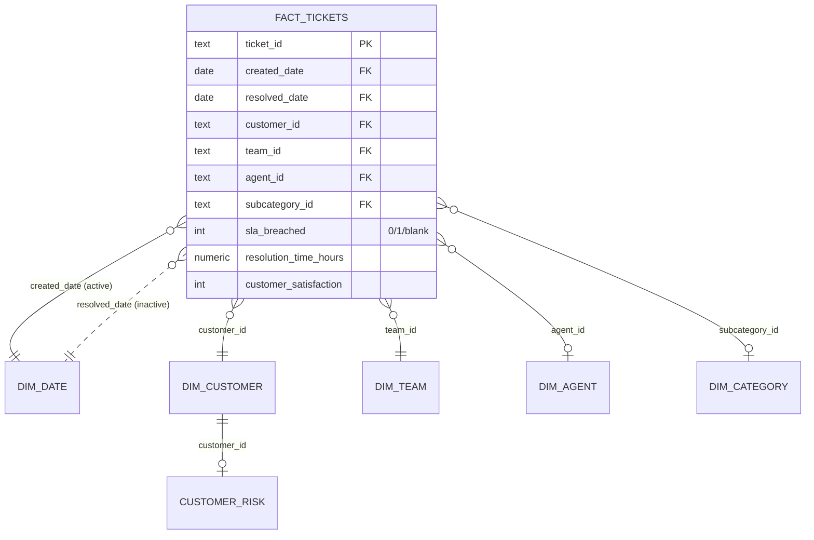

# Power BI implementation (Phase 8)

> All data is synthetic. A `.pbix` file is not included: it is a binary file that has to be built in
> Power BI Desktop (Windows only). This folder contains everything needed to build the report in
> about 30–45 minutes, plus acceptance values to prove it matches the SQL and web dashboard.

| File | Purpose |
|---|---|
| `README.md` | This guide: model, relationships, connection, pages, acceptance test |
| `measures.dax` | 40 DAX measures, grouped by display folder |
| `theme.json` | Report theme using the same validated palette as the web dashboard |
| `expected_values.py` / `.md` | The numbers your report must show (computed independently in pandas) |
| `../database/powerbi_views.sql` | SQL views the model imports (`analytics.pbi_*`) |

## 1. Star schema



| Power BI table | Source (PostgreSQL) | Grain | Type |
|---|---|---|---|
| Fact Tickets | `analytics.pbi_fact_tickets` | one row per valid ticket (22,090) | Fact |
| Dim Date | `analytics.dim_date` | one row per day, 2024–2025 | Dimension (mark as date table) |
| Dim Customer | `analytics.dim_customer` | customer (500 + Unknown) | Dimension |
| Dim Team | `analytics.dim_team` | resolver team (8) | Dimension |
| Dim Agent | `analytics.dim_agent` | agent (80) | Dimension |
| Dim Category | `analytics.dim_category` | subcategory (39) | Dimension |
| Dim SLA Target | `analytics.dim_sla_target` | SLA level × priority (16) | Reference (no relationship needed) |
| Customer Risk | `analytics.pbi_customer_risk` | customer, last 90 days | Dimension extension (1:1) |

Why a star schema: one fact table and conformed dimensions make filters predictable (single direction,
one-to-many), keep DAX simple, and compress well in VertiPaq. All business rules (duplicates excluded,
SLA/duration/FCR populations, repeat incidents) are already applied in SQL, so Power BI shows the same
numbers as the web dashboard.

## 2. Relationships

| From (many) | To (one) | Cardinality | Cross-filter | Active |
|---|---|---|---|---|
| Fact Tickets[created_date] | Dim Date[date] | * : 1 | Single | **Yes** |
| Fact Tickets[resolved_date] | Dim Date[date] | * : 1 | Single | No (use `USERELATIONSHIP`) |
| Fact Tickets[customer_id] | Dim Customer[customer_id] | * : 1 | Single | Yes |
| Fact Tickets[team_id] | Dim Team[team_id] | * : 1 | Single | Yes |
| Fact Tickets[agent_id] | Dim Agent[agent_id] | * : 1 | Single | Yes |
| Fact Tickets[subcategory_id] | Dim Category[subcategory_id] | * : 1 | Single | Yes |
| Customer Risk[customer_id] | Dim Customer[customer_id] | 1 : 1 | Both | Yes |

Hide all key columns and the raw 0/1 flag columns in report view; users work with dimension attributes
and measures only.

## 3. Date table

- `Dim Date` comes from the database (England & Wales bank holidays and the UK April fiscal year are
  included).
- **Modeling → Mark as date table → `date`.** This is required for `SAMEPERIODLASTYEAR`, `DATEADD`,
  `TOTALYTD` and `DATESINPERIOD`.
- Sort `month_name` by `month`, and `day_name` by `day_of_week`.
- Hierarchy: `year` → `quarter` → `month_name` → `date`. Add a second hierarchy, `fiscal_year` →
  `fiscal_quarter`.

## 4. Connect Power BI to PostgreSQL

1. Build the database first: `database/build_database.ps1`.
2. Power BI Desktop → **Get data → PostgreSQL database**.
   - Server: `localhost:5432`
   - Database: `it_service_intelligence`
   - Data connectivity mode: **Import**. The data set is small, and Import gives fast visuals and
     full DAX support.
3. Credentials: **Database** tab → user `itsi_app`, password = `DB_APP_PASSWORD` from your `.env`.
   This role is read-only and only sees the `analytics` schema.
4. If Power BI asks for encryption and your local server has no SSL, untick "Encrypt connections".
   This is fine for localhost only.
5. In the Navigator, tick the eight views in the table in section 1, click **Transform data**, rename
   the queries to the Power BI table names, then click **Close & apply**.
6. Create the relationships in section 2 (Model view) and mark the date table (section 3).
7. Create the measures: **Home → New measure** for each one in `measures.dax`. Alternatively, in
   Power BI Desktop's **TMDL view** or **Tabular Editor**, paste them in bulk. Put each section in a
   display folder.
8. **View → Themes → Browse for themes →** `powerbi/theme.json`.

**No PostgreSQL?** Get data → **Text/CSV** from `data/processed/`. Use `pbi_fact_tickets.csv`,
`dim_*.csv` and `pbi_customer_risk.csv`. These are the same rows exported by the build; the steps
from 5 onwards are unchanged.

**Refresh:** when the data is regenerated, run the database build, then **Home → Refresh** in Power BI.
For the Power BI Service, install an on-premises data gateway pointed at the database and schedule
the refresh.

## 5. Measures (`measures.dax`)

| Folder | Measures |
|---|---|
| Volume | Total Tickets, Open Tickets, Resolved Tickets, Open Past Target |
| SLA | SLA Population, SLA Breaches, **SLA Breach %**, **SLA Compliance %**, SLA Target Gap (pts), Response SLA Met %, Breach Status Colour |
| Resolution time | Avg Resolution Hours, **Median Resolution Hours**, P90 Resolution Hours |
| Quality | **FCR %**, **Reopen %**, Escalation %, Repeat Incident %, KB Usage % |
| Satisfaction | **Avg CSAT**, CSAT Responses, CSAT Response %, Avg CSAT (min 5 responses), CSAT Breached vs Met (pts) |
| Team comparison | Months In Context, **Tickets per Agent per Month**, Breach % vs Company (pts), Team Breach Rank, Workload Spread (max/min) |
| Time intelligence | Tickets PY, **Tickets YoY %**, Tickets YTD, SLA Breach % PM, **SLA Breach % MoM (pts)**, SLA Breach % PY, **SLA Breach % Rolling 3M**, SLA Breach % Previous Period, Tickets Resolved (by resolved date) |
| Customers | At-Risk Customers, Customers With Tickets |

Design notes for interviews:

- **Rates use `DIVIDE`.** Numerator and denominator are both counts, so a team with no resolved
  tickets shows blank, never an error or a misleading 0%.
- **Flags are 0/1 with blanks outside the population.** `sla_breached` is blank for open or invalid
  tickets, so `[SLA Population]` and `[SLA Breaches]` match the SQL definition exactly (BR-RULE-04).
- **Medians and percentiles are exact.** `MEDIAN` and `PERCENTILE.INC` interpolate the same way as
  PostgreSQL's `percentile_cont`, so the values match the SQL to two decimals.
- **The previous-period measure** uses the same-length window as the web dashboard, not the previous
  calendar month.
- **Status colours** (`Breach Status Colour`) are always paired with a data label or icon, so colour
  is never the only signal.

## 6. Report pages

| Page | Visuals | Slicers |
|---|---|---|
| **Executive overview** | Card row: Total Tickets, Open Tickets, SLA Compliance %, SLA Breach %, Avg / Median Resolution, FCR %, Reopen %, Avg CSAT. Each card shows the change vs `SLA Breach % Previous Period` (or the matching measure). Line: SLA Breach % by month, with a 15% constant line. Column: Total Tickets by month. Line: Avg CSAT by month. | Date range, Priority, Team, Region |
| **SLA performance** | Clustered column: SLA Compliance % by priority. Bar: SLA Breaches by category. Bar: SLA Compliance % by team (conditional colour = Breach Status Colour). Stacked column: ticket count by resolution-time bucket (calculated column below) and priority. Line: SLA Breach % by month, with priority as the legend. | Date, Priority, Team, Region |
| **Root cause** | Pareto: a combo chart of incident share (column) and cumulative share (line), with **both on the same % axis**. Matrix: root cause × priority with SLA Breach %, background colour from a sequential blue scale. Table: top repeat customer–subcategory pairs. Clustered column: Median Resolution Hours by escalation flag and priority. | Date, Team, Category |
| **Team performance** | Table: team scorecard (all team measures plus Team Breach Rank). Bar: Tickets per Agent per Month. Line: Total Tickets by month by team. Card: Workload Spread (max/min). | Date, Priority, Category |
| **Customer intelligence** | Table: customers with Total Tickets, Repeat Incident %, SLA Breach %, Avg CSAT (min 5 responses), and an at-risk flag icon. Bar: top 10 customers by volume. Card: At-Risk Customers. | Date, SLA level, Industry, Customer success manager |

Calculated column for the resolution-time bucket (Fact Tickets):

```dax
Resolution Bucket =
SWITCH ( TRUE (),
    ISBLANK ( 'Fact Tickets'[resolution_time_hours] ) || 'Fact Tickets'[in_duration_population] <> 1, BLANK (),
    'Fact Tickets'[resolution_time_hours] < 1, "1. < 1 h",
    'Fact Tickets'[resolution_time_hours] < 4, "2. 1-4 h",
    'Fact Tickets'[resolution_time_hours] < 8, "3. 4-8 h",
    'Fact Tickets'[resolution_time_hours] < 24, "4. 8-24 h",
    'Fact Tickets'[resolution_time_hours] < 72, "5. 1-3 days",
    'Fact Tickets'[resolution_time_hours] < 168, "6. 3-7 days",
    "7. > 7 days" )
```

Pareto cumulative % (measure, used on the root-cause page with `root_cause` on the axis):

```dax
Cumulative Incident Share =
VAR Current = CALCULATE ( [Total Tickets], 'Fact Tickets'[is_incident] = 1, 'Fact Tickets'[is_resolved] = 1 )
VAR AllCauses =
    ADDCOLUMNS ( ALLSELECTED ( 'Fact Tickets'[root_cause] ), "@n",
        CALCULATE ( [Total Tickets], 'Fact Tickets'[is_incident] = 1, 'Fact Tickets'[is_resolved] = 1 ) )
VAR Total = SUMX ( AllCauses, [@n] )
RETURN DIVIDE ( SUMX ( FILTER ( AllCauses, [@n] >= Current ), [@n] ), Total )
```

## 7. Optional: row-level security

To let each Team Lead see only their own team, create a role **Team Lead** with a filter on
`Dim Team`: `[team_lead_agent_id] = LOOKUPVALUE('Dim Agent'[agent_id], 'Dim Agent'[agent_name], USERPRINCIPALNAME())`.
In a real deployment this would map to an email column. Test it with **Modeling → View as**.

## 8. Acceptance test

With no slicers applied, your report must show the values in [`expected_values.md`](expected_values.md),
for example:

| Measure | Expected |
|---|---:|
| Total Tickets | 22,090 |
| Open Tickets | 250 |
| SLA Breach % | 18.15% |
| SLA Compliance % | 81.85% |
| Median Resolution Hours | 14.84 |
| FCR % | 25.18% |
| Avg CSAT | 3.97 |
| Network Operations SLA Breach % | 35.22% |
| SLA Breach %, December 2025 | 19.60% |
| Tickets YoY % (2025) | 20.50% |

These are identical to the PostgreSQL views (`analytics.kpi_overall`, `kpi_team`, `kpi_monthly`) and to
the web dashboard API. If a value differs, the usual causes are: the date table is not marked; the
date relationship is missing or inactive; a slicer is still applied; or `sla_breached` was imported
as text (set its type to whole number).

## 9. Screenshots to capture for the portfolio

See `docs/screenshots_checklist.md`.
